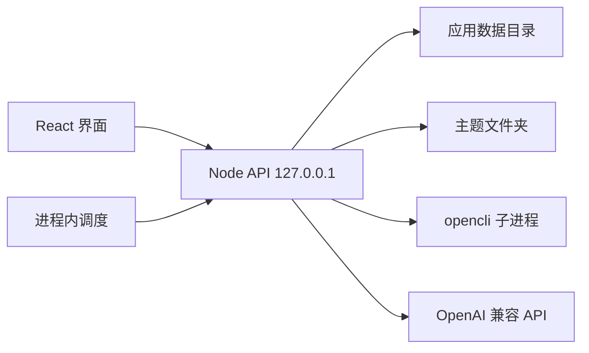

# SPEC: 主题跟进第一版

> Technical specification derived from: tasks/prd-topic-followup.md
> Generated: 2026-10-26 | Target branch: main | Commit: 99defe0

> 文档状态（2026-11-01）：以下为第一版技术设计快照。当前实现已改为项目内固定版本 OpenCLI、常驻采集进程、批量目录缓存和独立后台登录检测，并加入任务持久化与预算。原文中的子进程逐命令发现、登录检查和变化对比规则不代表全部现状，当前入口见 [README](../README.md) 与 [现状说明](智能体现状与理想.md)。

## 1. Summary

### 1.1 What This SPEC Covers

本 SPEC 规定个人本地使用的主题跟进 Web 应用第一版如何实现。一个 Node 进程在 `127.0.0.1` 提供 HTTP API，并托管 React 界面。每个主题挂钩一个本地文件夹，档案只写在该文件夹的五类路径里。首页主题列表、对话记录和「待确认动作」写在应用数据目录。信息源在运行时用 OpenCLI 发现。四种变化结论由纯函数计算。关键词预选、跨快照事件对齐、主题对话，以及无专用解析器时的正文抽取，调用 OpenAI 兼容 HTTP API。

### 1.2 PRD Reference

- Source: `tasks/prd-topic-followup.md`
- User Stories covered: US-001 … US-010
- Functional Requirements covered: FR-1 … FR-60

### 1.3 Design Decisions Summary

| Decision | Choice | Rationale |
|----------|--------|-----------|
| 运行形态 | 本机 Node 服务 + Vite/React。服务进程才是「应用正在运行」 | 浏览器标签没有稳定的文件系统、子进程和定时器。验收要求在浏览器里操作 |
| 语言与仓库 | npm workspaces，TypeScript strict。`packages/core` 放纯函数，`apps/server` 放 I/O，`apps/web` 放界面 | 每条用户故事都要求类型检查和 lint。对照规则必须能离线夹具测试 |
| 模型 | `POST {OPENAI_BASE_URL}/chat/completions`，Bearer `OPENAI_API_KEY`，模型名 `OPENAI_MODEL` | 用户已选 OpenAI 兼容接口。不绑定厂商 SDK |
| 主题登记与对话 | `%APPDATA%\AI_NewsFollowUp`（无 APPDATA 时用 `~/.ai-newsfollowup`） | 主题可改挂到任意目录，只扫描默认父目录会丢主题。文件区只展示 PRD 的五类档案，对话不能进主题文件夹 |
| 档案正文 | 主题文件夹内的 `主题.md`、`快照/*.json`、`简报/*.md`、`笔记/*.md`、`素材/*` | PRD 要求重启后仍以文件夹为准。快照用 JSON，便于对照；简报用带 frontmatter 的 Markdown，便于人读 |
| 信息源身份 | 适配器平台用 OpenCLI 命令字符串，例如 `bilibili search`。无适配器的平台用项目内浏览器配方 id，形如 `browser:<id>` | 清单随 `opencli list` 和本仓库配方变化。代码里不放站点参数表 |
| 可勾选条件 | 读命令、帮助里有且仅有关键词这一个必填参数、并且项目里写了把 `data` 收成统一条目的归一化 | 写操作不出现。能搜但不能归一化的命令仍显示，勾选框不可用，说明「暂不能纳入对比」 |
| 适配器采集 | 有搜索命令的已勾选平台，按该命令自己的 `--help -f json` 填关键词和 `-f json`，读 `{ok:true,data}` | 帮助里的 `browser: true` 只说明适配器内部可能开页面。产品仍只跑这条搜索命令，不再调用 `opencli browser` |
| 无适配器浏览器 | 只有项目里登记了配方、用户勾了它、并且这次 `list` 没有它的搜索命令时，才走 `opencli browser` | 网址由配方生成。同一轮收集共用 session `topic-<topicId>`，用 `open`，结束时 `close`。登录用本机已连接的 Chrome profile |
| OpenCLI 技能边界 | 运行时只用 list、命令帮助、auth status、搜索命令和 browser 会话。`opencli-adapter-author` 与 `opencli-autofix` 只在开发时用。不接入 `smart-search` | `smart-search` 在没指定网站时会去问 grok、doubao 或 gemini，会绕过用户勾选的平台 |
| 结论 | `packages/core` 的纯函数。简报句子由模板生成 | PRD 禁止把四种结论交给模型改写 |
| 事件对齐 | 先按平台集合切开条目，再只对「两边都勾选且本次成功」的条目做一次联合聚类 | 新勾选平台上的条目若混进同一次聚类，会把已有事件抬成升温 |
| 收集与追踪 | 第一次「现在收集」没有对照。之后的「现在收集」和「现在追踪」都对照时间上紧挨着的上一份快照。晨报单独选「前一个自然日的最后一份」 | US-004 只把「没有四种结论」限定在第一份快照。已有上一份时仍写「没有可对照的快照」与事实不符 |
| 晨报补跑 | 启动时每个主题最多补最近一个已到期、且该名义日期还没有晨报快照的档期 | FR-54 写的是补跑一次，不是按缺的每一天各补一次 |
| 自然日 | 操作系统本地时区的日历日期 | 单机个人工具。档期 `HH:mm` 也按本地时间 |
| 笔记正文 | 解析器抽出的可读正文，上限 20000 个 Unicode 码位，超出则截断并在文末写明 | PRD 只要求来源加可读正文 |
| 未配置模型 | 仍可建主题；关键词留空由人填。聚类退化为一条目一个事件。对话接口返回明确错误 | 对照夹具和界面不依赖密钥 |

---

## 2. Architecture

### 2.1 System Context

用户只跟浏览器里的界面交互。界面把请求发给本机服务。服务是唯一会写主题文件夹、读 OpenCLI、叫模型、跑晨报的进程。关掉浏览器标签不会停晨报；停掉 Node 进程才会。下次启动再按 FR-54 补最近一个档期。



OpenCLI 以本机已安装的 2.x 为准（写本 SPEC 时探测到 2.0.2）。采集流水线只使用这些调用：

```text
opencli list search --limit 100 --offset <n> -f json
opencli <site> <name> --help -f json
opencli auth status --site <site>[,<site>...] -f json
opencli <site> <name> <keyword> -f json
opencli browser open <配方生成的 url> --session topic-<topicId>
opencli browser state --session topic-<topicId>
opencli browser get text --session topic-<topicId>
opencli browser close --session topic-<topicId>
```

前四行是有搜索命令的适配器路径。后四行只用于没有搜索命令的浏览器配方，同一轮收集共用一个 session，采完一定 `close`。用 `open` 打开自己的页面，不用 `bind`，避免占住用户正在看的标签。Chrome 登录态来自本机已经连上的 profile，产品不保存账号。

`list` 与单条命令的成功包络都是 `{ ok: true, data }`。失败是 stdout 上的 `{ ok: false, error }`，并且退出码非 0。`auth status` 的 `--only` 取值为 `logged-in | not-logged-in | unknown | error`。本次探测 `auth status` 的正文时命令挂起，因此登录状态解析按 4.2 的宽容规则实现，调用超时 20 秒；超时不中断采集，对应站点记为 `unknown`。

### 2.2 Component Design

| 模块 | 职责 | 边界 |
|------|------|------|
| `apps/web` | 首页、三区工作台、调控面板、对话 | 不写文件，不计算结论，不拼 OpenCLI 参数 |
| `apps/server` | HTTP、文件夹、子进程、模型、调度、任务 | 结论计算调用 `packages/core`，不在路由里重写规则 |
| `packages/core` | 平台集合、结论、简报模板、计划校验、路径段校验 | 无 `fs`、无 `fetch`、无子进程 |
| OpenCLI 归一化 | 适配器把 `data` 收成统一条目。浏览器配方把 `get text` 的正文收成统一条目 | 只存在于 server。归一化是项目里的函数，不是站点大全，也不交给对话模型 |
| 模型客户端 | 拆关键词和预选平台、给事件起标题并做联合聚类、解析笔记、回答文件夹里的内容 | 对话循环不拿到 OpenCLI 工具。收集、追踪、晨报和调控面板上的确认才跑采集流水线 |
| 开发用 OpenCLI 技能 | `opencli-adapter-author` 给新网站写适配器。`opencli-autofix` 只在适配器坏了时由开发修 | 不出现在用户界面，也不进入用户的对话 |

### 2.3 Module Interactions

**新建到确认**

1. `POST /api/topics` 分配 `topicId`，在默认父目录建空文件夹和四个子目录，写入 `status: pending` 的 `主题.md`，再把路径登记进 `index.json`。
2. 服务读取信息源目录（可用缓存）。
3. 模型根据原话和「当前可勾选」命令返回关键词与预选命令。服务丢掉不可勾选的 id，并取消「需要登录且未登录」的预选。
4. 把草稿写回 `主题.md`，状态仍是 `pending`。
5. 界面打开工作台，工作面板落在「调控」。
6. `POST /api/topics/:id/confirm` 校验关键词和平台。通过后把状态改为 `confirmed`。此前置任何采集。

**一次采集**

调控面板的「现在收集」「现在追踪」、晨报调度，以及待确认动作的确认，走同一条流水线。对话循环不走。

1. 路由要求计划已确认，并拿到该主题的互斥锁。
2. `opencli list search` 得到当前命令。对每个仍存在的已勾选搜索命令执行 `--help -f json`，只按帮助组装参数。
3. `opencli auth status` 读取这些站点的登录状态，写入本份快照的平台记录。未登录不取消用户已经勾上的平台。
4. 有搜索命令的已勾选平台：逐个关键词执行该搜索命令。归一化函数只接收成功时的 `data`。
5. 没有搜索命令、但用户勾了的浏览器配方：打开同一个 `topic-<topicId>` session，按配方 URL 取回页面文本并归一化，然后 `close`。
6. 同一 URL 在快照内合并。某个平台失败只把该平台记为失败。
7. 按触发类型选择基线快照。用平台集合切开条目。比较集交给模型做联合聚类；新勾选平台的条目单独成组。
8. 纯函数产出结论。模板写出简报。快照 JSON 与简报 Markdown 用临时文件写入后改名。锁释放。

**对话里的收集或改平台**

1. 模型只返回意图 JSON。
2. 计划仍是 `pending` 时，服务不写 `pending-action.json`，回复要求先在调控面板确认计划。
3. 计划已确认且意图是收集、追踪或改计划时，只写待确认动作。调控面板展示该动作。
4. 用户在调控面板确认后，才调用与按钮相同的采集或保存计划函数。
5. 意图是整理时直接走笔记管道，不经过待确认动作。

### 2.4 File Structure

```text
package.json                          [NEW] workspaces、脚本
tsconfig.base.json                    [NEW]
README.md                             [MODIFY] 只补启动、环境变量和数据位置
apps/web/                             [NEW] Vite + React + React Router
apps/server/src/index.ts              [NEW] 监听、托管静态资源、启动调度
apps/server/src/routes/               [NEW] topics、catalog、jobs、chat、files
apps/server/src/opencli/              [NEW] spawn、目录发现、登录状态、归一化、浏览器配方
apps/server/src/model/                [NEW] OpenAI 兼容客户端与三类提示
apps/server/src/topic/                [NEW] 登记表、主题.md、文件夹、任务锁
apps/server/src/jobs/                 [NEW] 收集、追踪、晨报
apps/server/src/notes/                [NEW] 解析器登记与笔记写入
apps/server/src/chat/                 [NEW] jsonl、意图守卫、引用校验
apps/server/src/schedule/             [NEW] 档期与补跑
packages/core/src/                    [NEW] 类型、平台集合、结论、简报、校验
packages/core/test/                   [NEW] 夹具
```

运行时目录不在仓库里：

```text
%APPDATA%\AI_NewsFollowUp\
  index.json
  catalog-cache.json
  topics\<topicId>\chat.jsonl
  topics\<topicId>\pending-action.json

%USERPROFILE%\AI_NewsFollowUp\topics\<slug>-<4位>\
  主题.md
  简报\
  快照\
  笔记\
  素材\
```

---

## 3. Data Model

### 3.1 Schema Changes

没有数据库。下面的文件就是存储。

**`index.json`**

```yaml
version: 1
topics:
  - id: uuid
    folderPath: 绝对路径
    createdAt: ISO-8601，含偏移
```

登记表只保存「有哪些主题、文件夹在哪」。卡片上的原话、采集时间和条数每次从文件夹读。

**`主题.md`**

YAML frontmatter，正文重复原话，供人直接打开。

```yaml
id: uuid
status: pending | confirmed
utterance: 原话
keywords: [字符串]
platforms:
  - command: "bilibili search"
    selected: true
morningReport:
  enabled: false
  time: "08:00"   # 未设置时为 null
folderPath: 绝对路径
createdAt: ISO-8601
updatedAt: ISO-8601
confirmedAt: ISO-8601 | null
```

`platforms` 只记录用户勾选过的命令，不把整个目录抄进文件。未勾选的命令下一次打开调控面板时仍从运行时目录渲染。

**快照 `快照/YYYYMMDD-HHmmss.json`**

文件名用本地时间。同一秒冲突时追加 `-2`、`-3`。

```yaml
id: 文件名去掉 .json
topicId: uuid
collectedAt: 实际开始写入前的时刻，ISO-8601
trigger: collect | track | morning
nominalDate: YYYY-MM-DD | null    # 仅 morning
scheduledTime: HH:mm | null       # 仅 morning
baseline:
  kind: none | previous | yesterday | yesterday-missing | no-comparable-platforms
  snapshotId: string | null
  collectedAt: ISO-8601 | null
  comparisonDate: YYYY-MM-DD | null
  label: 简报开头那句对照说明
plan:
  keywords: [字符串]
  platforms: [command]
platforms:
  - command: "bilibili search"
    transport: adapter | browser
    status: success | failed
    error: 字符串或省略
    itemCount: 数字
items:
  - id: 快照内唯一
    title: 字符串
    url: http(s) URL
    platform: command
    publishedAt: ISO-8601
    summary: 字符串，允许空串
events:
  - id: eventKey
    title: 代表标题
    itemIds: [id]
    platforms: [command]
clustering:
  degraded: false
  truncated: false
```

**简报 `简报/<与快照相同的文件干>.md`**

Frontmatter 给界面和首页卡片用，正文是模板生成的短文。

```yaml
snapshotId: 字符串
trigger: collect | track | morning
collectedAt: ISO-8601
hasVerdicts: true | false
baselineLabel: 字符串
comparisonDate: YYYY-MM-DD | null
counts:
  appeared: 0
  heating: 0
  ongoing: 0
  fading: 0
  newSources: 0
verdicts: []        # 结构见 3.2，无链接的结论不进这个数组
newSources: []
```

**笔记 `笔记/YYYYMMDD-HHmmss-<短标题>.md`**

```yaml
source: URL 或素材相对路径
sourceKind: url | material
bodyKind: text
createdAt: ISO-8601
truncated: false
```

正文是可读文本。`truncated: true` 时文末另起一行：`（正文已截断，原长超过 20000 字）`。

**素材 URL**

`素材/YYYYMMDD-HHmmss.url`，文件内容是一行 `http://` 或 `https://` URL。界面「保存链接」写这个文件。用户自己放进 `素材/` 的其它文件原样列出。

**`chat.jsonl`**

每行一个 JSON 对象：`{ id, role: user | assistant, content, createdAt, citations }`。`citations` 的元素是 `{ type: file, path }` 或 `{ type: url, url }`。`path` 相对主题文件夹，使用 `/` 分隔。

**`pending-action.json`**

```yaml
type: collect | track | update-plan
keywords: []          # 仅 update-plan
platforms: []         # 仅 update-plan，command 字符串
createdAt: ISO-8601
```

文件不存在表示没有待确认动作。

**`catalog-cache.json`**

```yaml
fetchedAt: ISO-8601
commands: []          # 见 3.2 CommandCatalogEntry
```

缓存有效期 24 小时。调控面板提供「重新读取信息源」，强制重写缓存。

### 3.2 Entity Definitions

```ts
type TopicStatus = "pending" | "confirmed";
type Trigger = "collect" | "track" | "morning";
type PlatformStatus = "success" | "failed";
type Transport = "adapter" | "browser";
type BaselineKind =
  | "none"
  | "previous"
  | "yesterday"
  | "yesterday-missing"
  | "no-comparable-platforms";
type VerdictKind = "appeared" | "heating" | "ongoing" | "fading";

interface UnifiedItem {
  id: string;
  title: string;
  url: string;
  platform: string;
  publishedAt: string;
  summary: string;
}

interface Verdict {
  kind: VerdictKind;
  eventKey: string;
  title: string;
  url: string;
  prevCount: number;
  currCount: number;
  addedPlatforms: string[];
  detail: string;
}

interface NewSource {
  title: string;
  url: string;
  platform: string;
}

interface CommandCatalogEntry {
  command: string;
  site: string;
  description: string;
  access: "read";
  transport: Transport;
  keywordArg: string;
  selectable: boolean;
  disabledReason?: "not-normalizable";
  loginState: "logged-in" | "not-logged-in" | "unknown" | "error";
}

interface TopicCard {
  id: string;
  utterance: string;
  folderPath: string;
  folderMissing: boolean;
  lastCollectedAt: string | null;
  morningEnabled: boolean;
  counts: { appeared: number; heating: number; fading: number; comparisonDate: string } | null;
}
```

`counts === null` 表示还没有任何 `hasVerdicts === true` 的简报。有这种简报时，取其中 `collectedAt` 最新的一份，即使更新的一份简报没有四种结论。

界面文案与 `VerdictKind` 的对应是固定的：`appeared` 新出现，`heating` 升温，`ongoing` 还在，`fading` 正在消退。新加入的源不是 `VerdictKind`。

### 3.3 Relationships

- `index.json` 的一条记录对应一个文件夹。一个文件夹同一时间只被一个 `topicId` 挂钩。
- 一份快照对应一份同文件干的简报。
- 快照里的 `items[].platform` 与 `platforms[].command` 使用同一个命令字符串。
- 结论里的 `eventKey` 只在这一次对照的比较集里有意义，不写入后续快照当永久 id。
- 笔记、素材、对话都不进入 `items`，也不进入来源条数。
- 对话引用的 `file.path` 必须能解析到该主题文件夹内的真实文件。引用的 URL 必须出现在该主题任一快照的 `items[].url`、任一笔记的 `source`，或任一 `.url` 素材的内容里。

### 3.4 Migration Plan

第一版没有旧数据。文件 `version` 现在只有 `1`。服务启动时若 `index.json` 不存在，写成 `{ "version": 1, "topics": [] }`。

写入一律先写同目录临时文件再 `rename`。读取到损坏的 JSON 或无法解析的 `主题.md` frontmatter 时，该主题在首页显示「档案无法读取」，不覆盖原文件。

改挂文件夹时：

1. 新路径必须是绝对路径，且解析后的真实路径不等于另一主题的路径。
2. 新路径里如果已有 `主题.md`，其 `id` 必须等于当前主题，否则拒绝。
3. 缺少的 `简报`、`快照`、`笔记`、`素材` 目录补齐。
4. 把当前计划写入新路径的 `主题.md`，更新 `index.json`。
5. 旧路径上的文件留在原地。

回滚方式是停进程后用手改回 `index.json` 的 `folderPath`，并保留旧文件夹。应用不提供删除主题。

---

## 4. API Design

基础地址是 `http://127.0.0.1:4177`。开发时 Vite 把 `/api` 代理到该端口。生产启动由 server 托管 `apps/web/dist`，浏览器与 API 同源。没有登录接口。

### 4.1 Endpoints

| Method | Path | Description | Auth | Request | Response |
|--------|------|-------------|------|---------|----------|
| GET | `/api/health` | 进程、opencli 是否在 PATH、模型环境是否齐全 | 无 | — | `{ ok, opencli, model }` |
| GET | `/api/topics` | 首页卡片 | 无 | — | `{ topics: TopicCard[] }` |
| POST | `/api/topics` | 用一句话新建并挂钩新文件夹 | 无 | `{ utterance }` | `{ topic, draft }` |
| GET | `/api/topics/:id` | 工作台所需的计划、待确认动作、默认页签 | 无 | — | `{ topic, pending, defaultTab }` |
| POST | `/api/topics/:id/confirm` | 确认计划 | 无 | `{ keywords, platforms, folderPath }` | `{ topic }` |
| PATCH | `/api/topics/:id/plan` | 修改已确认计划或晨报 | 无 | 见 4.2 | `{ topic }` |
| POST | `/api/topics/:id/folder/open` | 用系统文件管理器打开挂钩文件夹 | 无 | — | `{ ok: true }` |
| GET | `/api/catalog` | 信息源目录。过期则重建 | 无 | — | `{ fetchedAt, commands }` |
| POST | `/api/catalog/refresh` | 强制重建目录缓存 | 无 | — | 同上 |
| GET | `/api/topics/:id/tree` | 文件区五类清单 | 无 | — | `{ entries }` |
| GET | `/api/topics/:id/file` | 预览文件夹内文本 | 无 | `?path=` | `{ path, text, truncated }` |
| POST | `/api/topics/:id/materials` | 把一条 URL 写入 `素材/` | 无 | `{ url }` | `{ path }` |
| POST | `/api/topics/:id/notes` | 整理一条链接或一份素材 | 无 | `{ url } 或 { materialPath }` | `{ path }` 或 4.3 的错误 |
| POST | `/api/topics/:id/jobs` | 开始收集或追踪 | 无 | `{ kind: "collect" \| "track" }` | `{ job }` |
| GET | `/api/topics/:id/jobs/current` | 当前任务进度 | 无 | — | `{ job: Job \| null }` |
| GET | `/api/topics/:id/overview` | 总状况 | 无 | — | 见 4.2 |
| GET | `/api/topics/:id/brief/latest` | 概括页签 | 无 | — | `{ brief: BriefView \| null }` |
| GET | `/api/topics/:id/snapshots/:snapshotId` | 文件区点开一次快照 | 无 | — | `{ snapshot, briefText }` |
| GET | `/api/topics/:id/chat` | 读对话 | 无 | — | `{ messages }` |
| POST | `/api/topics/:id/chat` | 发一句 | 无 | `{ text }` | `{ messages, pending }` |
| POST | `/api/topics/:id/pending/confirm` | 执行待确认动作 | 无 | — | `{ topic, job? }` |
| DELETE | `/api/topics/:id/pending` | 取消待确认动作 | 无 | — | `{ ok: true }` |

晨报不设对外「立即晨报」按钮。调度器在进程内调用与 `jobs` 相同的执行函数，`kind` 为 `morning`。

### 4.2 Request/Response Schemas

**POST `/api/topics`**

```json
{ "utterance": "跟进本地模型在开发者圈子里的讨论" }
```

`utterance` 去掉首尾空白后长度 1–200。响应里的 `draft.keywords` 与 `draft.platforms` 是服务过滤后的预选。`defaultTab` 在 `pending` 时为 `control`，在 `confirmed` 时为 `overview`。

**POST `/api/topics/:id/confirm`**

```json
{
  "keywords": ["本地模型"],
  "platforms": ["bilibili search"],
  "folderPath": "D:\\AI_NewsFollowUp\\topics\\本地模型-a1b2"
}
```

`keywords`：去空白、去重、保持顺序，每条 1–40 字，1–20 条。`platforms`：1–20 个命令字符串，每个都必须在当次目录里 `selectable === true`。`folderPath` 规则见 3.4。成功后 `status` 为 `confirmed`。

**PATCH `/api/topics/:id/plan`**

请求体是下面字段的任意非空子集：

```json
{
  "keywords": ["本地模型", "推理引擎"],
  "platforms": ["bilibili search"],
  "folderPath": "D:\\archive\\topic-a",
  "morningReport": { "enabled": true, "time": "08:00" }
}
```

只更新出现的字段。保存不删除 `快照/`、`简报/`、`笔记/`、`素材/`。`morningReport.enabled === true` 时必须带合法 `time`（`HH:mm`，00:00–23:59），且该主题至少已有一份快照。关闭晨报不要求快照。`pending` 主题拒绝这个接口，计划编辑走确认接口。

**GET `/api/topics/:id/overview`**

```json
{
  "empty": false,
  "heading": "这次看到的事件",
  "baselineLabel": "没有可对照的快照。",
  "hasVerdicts": false,
  "groups": { "appeared": [], "heating": [], "ongoing": [], "fading": [] },
  "newSources": [],
  "failures": [{ "command": "bilibili search", "error": "timeout" }]
}
```

没有快照时 `empty: true`，`heading` 为「尚未收集」。有四种结论时 `heading` 为「总状况」，分组顺序是新出现、升温、还在、正在消退，`newSources` 单独列出。`heading` 在没有结论时用「这次看到的事件」，并展示事件列表字段 `events: [{ title, url, platforms }]`。

**Job**

```json
{
  "id": "uuid",
  "kind": "collect",
  "state": "running",
  "startedAt": "2026-10-26T08:00:00+08:00",
  "finishedAt": null,
  "snapshotId": null,
  "error": null,
  "steps": [
    { "command": "bilibili search", "keyword": "本地模型", "state": "success" }
  ]
}
```

`state` 取 `running | succeeded | failed`。任务只留在内存。进程在写完快照之前退出，则磁盘上没有半份快照。界面每秒轮询 `jobs/current`，直到 `state` 不再是 `running`。

**POST `/api/topics/:id/chat` 的服务端行为**

模型必须返回一个 JSON 对象，形状为：

```json
{
  "intent": "discuss",
  "answer": "升温指的是上次 1 条、这次 3 条。",
  "citations": [{ "type": "file", "path": "简报/20261026-080000.md" }],
  "keywords": [],
  "platforms": [],
  "url": "",
  "materialPath": ""
}
```

`intent` 只允许 `discuss | collect | track | update-plan | organize`。其它取值按 `discuss` 处理，并且不创建待确认动作。`collect`、`track`、`update-plan` 在计划已确认时写入 `pending-action.json`。`organize` 使用 `url` 或 `materialPath` 调用笔记管道。

**目录条目**

`CommandCatalogEntry` 见 3.2。`selectable: false` 的条目仍然返回，供界面显示「暂不能纳入对比」。命令能归一化时就保持可勾选。`loginState === "not-logged-in"` 时界面显示「需要登录」，新建草稿不预选它。用户可以手动勾上。确认接口接受这个勾选；真的采不到时按平台失败写入快照，不在确认阶段拦截。

不预选由服务端过滤模型草稿完成，不靠界面单独记住。

**OpenCLI 登录状态宽容解析**

从 `{ ok: true, data }` 里找数组。数组元素里，站点名按 `site`、`id`、`name` 的顺序取第一个字符串；状态按 `status`、`state` 的顺序取。状态值必须是 `logged-in | not-logged-in | unknown | error`。解析不到的站点记为 `unknown`。实现时把一次真实 `opencli auth status --site bilibili -f json` 的字段名写进解析器测试。若真实字段与上述候选不同，只改解析器，不改调用方。

**归一化输入**

通用归一化器在帮助信息同时满足下列条件时 `supports(help) === true`：

- `columns` 含标题列：`title` 或 `name`
- 含链接列：`url`、`link` 或 `href`
- 含时间列：`pubdate_ts`、`pubdate`、`published_at`、`publishedAt`、`time`、`date`、`created_at`、`datetime`
- 含摘要列：`desc`、`description`、`summary`、`snippet`、`abstract`、`content`

行数据按 `data`（数组）、`data.items`、`data.rows`、`data.results` 的顺序取。一行必须有非空标题、`http(s)` 链接和可解析时间，否则丢掉该行，平台仍算成功。`pubdate_ts` 为数字时按 Unix 秒解析，大于 `1e12` 时按毫秒。摘要列缺失时该命令不能用通用归一化器；摘要列存在但值为空串时保留条目。

专用归一化器以命令字符串注册，优先于通用规则。第一版可以只有通用归一化器。后来为某条命令补上专用归一化器后，该命令在下次读目录时变为可勾选，不用改发现流程。

**笔记解析器**

```ts
interface BodyReader {
  id: string;
  supports(target: { url?: string; materialPath?: string }): boolean;
  read(target: { url?: string; materialPath?: string }): Promise<{ text: string }>;
}
```

第一版内置两个读取器，都注册在数组里，按注册顺序匹配：

1. `material-text`：素材相对路径指向的文件是 UTF-8 文本，且不是空文件。二进制或空文件不匹配。
2. `html-article`：`http(s)` URL 用 `GET` 取回 `Content-Type` 含 `text/html` 或 `text/plain` 的响应，再用模型从正文里抽出可读文本。响应不是文本、状态码不是 2xx、或抽出结果为空时，这个读取器失败。

不把站点写进 `if (host === "bilibili")` 这类分支。某个平台以后要专用解析，就再注册一个 `BodyReader`，放在 `html-article` 之前。

### 4.3 Error Responses

错误体统一为：

```json
{ "error": { "code": "PLAN_NOT_CONFIRMED", "message": "请先确认采集计划。" } }
```

`message` 用中文，可直接显示。完整码表在第 6 节。

### 4.4 Breaking Changes

仓库没有已发布客户端。本 SPEC 的路径和文件名是第一版契约。`index.json` 的 `version` 不为 `1` 时，服务拒绝启动并打印原因，避免把未知登记表写坏。

---

## 5. Business Logic

### 5.1 Core Algorithms

**信息源发现**

调控面板打开时做一次，采集开始时再做一次。两次规则相同。

1. 分页调用 `opencli list search --limit 100 --offset <n> -f json`，直到没有 `nextOffset`。
2. 保留 `access === "read"` 的命令。`access` 不是 `read` 的命令不出现。
3. 命令按空白拆成两段 `site` 与 `name`。不是两段的去掉。`name` 属于写操作词表时去掉，不进入清单：`post`、`publish`、`like`、`unlike`、`comment`、`reply`、`send`、`delete`、`remove`、`follow`、`unfollow`、`star`、`unstar`、`bookmark`、`upload`、`create`、`update`、`edit`、`subscribe`、`unsubscribe`、`share`、`vote`。
4. 对其余命令执行 `--help -f json`。可勾选的命令必须有且只有一个没有默认值的必填参数，并且它是名为 `query`、`keyword`、`q` 或 `keywords` 的字符串位置参数。另有必填参数时，产品不替它填值，该命令显示为不可选。
5. 项目里有归一化器能从该命令的 `data` 收成统一条目时，`selectable: true`，`transport: adapter`。否则保留在目录中，`disabledReason: not-normalizable`，界面说明「暂不能纳入对比」。
6. 帮助里的 `browser: true` 不改变 `transport`，也不把这条命令送进 `opencli browser`。
7. 对目录中的 `site` 调用一次 `opencli auth status --site a,b,c -f json`，超时 20 秒。`loginState === "not-logged-in"` 的平台显示「需要登录」，并且不进入模型预选。用户可以手动勾上。`unknown`、`error` 和超时不显示这句，也不阻止手选。
8. 项目内浏览器配方另行加入目录，`transport: browser`，id 为 `browser:<recipeId>`。配方自带搜索 URL 模板和归一化，所以默认可勾选。某个配方的站点已经有可勾选搜索命令时，只保留搜索命令，不显示配方。第一版配方表是空数组。空表时界面上没有浏览器平台，采集流水线的 browser 分支不发命令。

发现过程不把 GitHub、B 站、小红书写进源码。它们只有在当次 `list` 结果里满足第 2–5 步时才会出现。

**执行一条搜索命令**

参数只来自该命令刚刚取到的帮助：`[site, name, keyword, "-f", "json"]`。不追加 `--limit`、`--window` 或任何按站点写死的选项。使用 `spawn`，`shell: false`。超时 90 秒。

判定：

| stdout 与退出码 | 平台状态 |
|-----------------|----------|
| 退出码 0，且 JSON 为 `{ ok: true, data }` | 把 `data` 交给该命令的归一化函数。得到 0 条时 `success`，`itemCount: 0` |
| `{ ok: false, error }`、退出码非 0、超时、或 stdout 不是上述成功包络 | `failed`，保存 `error.message`。不使用已归一化的半截结果 |

每个已勾选平台对每个关键词跑一遍。一个平台只要有一次失败，该平台在这份快照里记 `failed`，并丢弃该平台本轮已得到的条目。这样对照不会把「后一个关键词没跑成」看成热度下降。全部关键词都成功时，把该平台条目合并进快照。

计划里勾过、但这次 `list` 已经没有的搜索命令，记为该平台 `failed`，原因是命令不在当前清单。不改写其它平台的条目。

**执行浏览器配方**

仅当已勾选 id 以 `browser:` 开头，且这次 `list` 里该站点没有可勾选搜索命令。session 名为 `topic-<topicId>`。对每个关键词依次：

```text
opencli browser open <recipe.searchUrl(keyword)> --session topic-<topicId>
opencli browser state --session topic-<topicId>
opencli browser get text --session topic-<topicId>
```

`searchUrl` 是配方代码里的函数。用户输入、对话文本和模型输出都不能当成这个 URL。`state` 用来确认页面已经打开；`get text` 的正文交给配方自己的归一化函数。任一命令失败、超时，或归一化抛错，该配方记 `failed`。`ok: true` 且归一化得到 0 条，记 `success`，`itemCount: 0`。

无论成功或失败，本轮结束前执行 `opencli browser close --session topic-<topicId>`。没有浏览器配方被勾选时，不调用 `opencli browser`。

归一化结果写入 `快照/` 的 `items`。空结果和命令失败分两栏记在 `platforms[]`，对照算法只把 `failed` 移出比较集。因此一个站失败时，这个站自己的旧条目和别的站的旧条目都不会变成正在消退。成功但 0 条的平台仍留在比较集里。

**URL 合并**

在聚类之前，对同一快照的条目做 Unicode NFC 和首尾空白折叠，URL 字符串全等的只留第一条。不做主机名小写、不去 query、不去尾部斜杠。

**选基线**

设本次快照的 `collectedAt` 为 T，已有快照按 `collectedAt` 升序。

- `collect` 或 `track`：基线是 `collectedAt < T` 的最后一份。没有则为 `none`。
- `morning`：名义日期是档期所属本地日 `D`。基线是本地日期等于 `D` 的前一个日历日、且 `collectedAt` 最晚的那一份。该日没有快照则为 `yesterday-missing`，不用更早的快照。
- `track` 在已有快照数为 0 时不允许创建任务。
- `collect` 允许在 0 份快照时创建任务，基线为 `none`。

**平台集合**

```text
both     = prevSelected ∩ currSelected
failed   = both 中本次 status 为 failed 的命令
compare  = both − failed
new      = currSelected − prevSelected
dropped  = prevSelected − currSelected
```

比较条目 = 基线快照和本次快照里 `platform ∈ compare` 的条目。  
新加入的源 = 本次快照里 `platform ∈ new` 且本次该平台 `success` 的条目。  
`dropped` 与 `failed` 上的条目不进入比较集，也不进入新加入的源。

**联合聚类**

比较集条目带 `side: prev | curr` 和快照内 `id`，一次模型调用返回 `{ "groups": string[][] }`，`groups` 里的 id 必须正好覆盖每条比较条目一次。校验通过则同一 group 共享一个 `eventKey`。校验失败则每条比较条目单独一个 `eventKey`，快照 `clustering.degraded = true`。

比较集超过 120 条时，按 `side`、`platform`、`title` 排序后只把前 120 条送进模型，其余每条单独一个 `eventKey`，`clustering.truncated = true`。条目仍全部留在快照里。

新加入的源条目不参加这次调用。它们按同一聚类函数在自己的集合里分组，只为了展示，分组结果不写进结论条数。

模型提示要求：同一件事的 id 放进同一组；标题明显不是同一件事的 id 分开；只输出 JSON。温度 0。

**结论**

对每个 `eventKey`：

```text
prevCount = 该键在基线侧的条目数
currCount = 该键在本次侧的条目数
addedPlatforms = 本次侧平台集合 − 基线侧平台集合
```

| 条件 | 结论 |
|------|------|
| `prevCount = 0` 且 `currCount > 0` | 新出现 |
| `prevCount > 0` 且 `currCount = 0` | 正在消退 |
| `prevCount > 0` 且 `currCount > 0` 且（`currCount > prevCount` 或 `addedPlatforms` 非空） | 升温 |
| `prevCount > 0` 且 `currCount > 0` 且 `currCount ≤ prevCount` 且 `addedPlatforms` 为空 | 还在 |

代表标题：优先取本次侧最长标题，否则取基线侧最长标题。链接：新出现、升温、还在取本次侧 URL 升序的第一条；正在消退取基线侧 URL 升序的第一条。没有 `http(s)` 链接的结论丢弃，不写入简报，也不计入 `counts`。

升温的 `detail`：

- 条数变多：`上次 {prevCount} 条，这次 {currCount} 条`
- 有新增平台：`新增平台：{命令列表}`
- 两者都有：两句用中文分号连起来

其它结论的 `detail` 为空串。

**何时 `hasVerdicts`**

基线 `kind` 是 `previous` 或 `yesterday`，并且 `compare` 非空时为 true，即使四类条数都是 0。`none`、`yesterday-missing`、`no-comparable-platforms` 时为 false。全部平台失败时 `compare` 为空，`kind` 记为 `no-comparable-platforms`，不产生正在消退。

**简报正文**

模板按固定顺序输出：第一行是 `baseline.label`，然后是有条目的章节。章节标题只使用「新出现」「升温」「还在」「正在消退」「新加入的源」「这次看到的事件」。每条一个列表项，末尾是 Markdown 链接，链接文字为「原文」。没有结论的第一份快照只输出「这次看到的事件」。不调用模型写这段文字。

`baseline.label` 的句子：

| kind | 句子 |
|------|------|
| `none` | 没有可对照的快照。 |
| `yesterday-missing` | 昨天（{日期}）没有可对照的快照。 |
| `previous` | 对照 {本地 YYYY-MM-DD HH:mm} 的快照。 |
| `yesterday` | 对照前一个自然日（{日期}）的最后一份快照，采集时间 {HH:mm}。 |
| `no-comparable-platforms` | 本次没有可对照的平台结果，不把缺少的结果写成热度变化。 |

**晨报档期**

每个已确认、晨报开启、且至少有一份快照的主题，在本地时间到达 `morningReport.time` 时执行一次，`nominalDate` 为当天日期。该 `nominalDate` 已经存在 `trigger: morning` 的快照则跳过。

启动时对每个这样的主题只看「不超过现在的最近一个档期」：

- 若今天的 `HH:mm` 已过，候选名义日期是今天。
- 否则候选是昨天。
- 该名义日期已有晨报快照则不补。
- 没有则补跑一次。`collectedAt` 是实际运行时刻，`nominalDate` 仍是候选日期。对照日是该名义日期的前一个日历日。
- 更早的缺口不补。

同一主题的手动任务和晨报共用一把锁。锁被占用时，晨报延后到下一次调度检查（每 30 秒），不并行开第二份快照。

**对话上下文**

发给模型的材料只包括：`主题.md` 全文、最新一份简报全文、最新一份快照里最多 80 个事件的标题和 URL、最多 8 篇笔记的路径和各前 1500 字、`素材/` 的文件名，以及 `.url` 素材的 URL。系统指令要求回答只使用这些材料；材料里没有的内容要说明文件夹里没有。服务丢掉无法按 3.3 核验的引用。历史只附带最近 40 条 `chat.jsonl`。

**预选提示**

输入是原话和可勾选命令的 `command`、`description`、`loginState`。输出 `{ keywords, platforms }`。服务再滤掉不可勾选的 id，以及 `loginState === "not-logged-in"` 的预选。模型失败时关键词为空数组，平台都不预选，主题仍然创建。

### 5.2 Validation Rules

- 确认和保存计划时，关键词与平台的数量、长度、可勾选性按 4.2。
- 采集、追踪、晨报读取磁盘上的 `主题.md`，使用已确认的关键词和 `selected: true` 的平台。
- 关键词 0 条或选中平台 0 个时，确认按钮在界面上不可用，服务返回 `PLAN_INVALID`。
- 用户提交的平台字符串若不在当次目录的可勾选集合里，整次确认拒绝。
- 任意 URL 不能作为 `platforms` 的元素。
- 文件预览的 `path` 经 `path.resolve` 后必须仍在挂钩文件夹内。拒绝绝对路径、盘符和 `..`。
- 笔记的 `materialPath` 使用同一规则，且必须落在 `素材/` 下。
- 整理请求在计划 `confirmed` 后可用，不要求已有快照。`pending` 时返回 `PLAN_NOT_CONFIRMED`。
- 空字符串 URL、不是 `http(s)` 的 URL，返回 `NOTE_EMPTY`，不创建文件。

### 5.3 State Machine

主题状态：

```text
pending --confirm--> confirmed
```

没有从 `confirmed` 回到 `pending` 的转换。已确认计划的修改是 `confirmed` 内部的字段更新。

采集任务：

```text
running --写入成功--> succeeded
running --开跑前失败或进程内异常--> failed
```

平台失败仍使任务 `succeeded`，只要快照文件写完。`failed` 只用于没有写出快照的情况，例如找不到 `opencli`、计划未确认、或写盘失败。

待确认动作：

```text
无 --对话提出收集/追踪/改计划--> 有
有 --调控面板确认--> 无，并执行
有 --调控面板取消--> 无，不写计划、不写快照
```

新的同类对话覆盖旧的 `pending-action.json`。覆盖前一次还没执行的动作。

### 5.4 Edge Cases

| 情况 | 行为 |
|------|------|
| 第一份快照 | `hasVerdicts: false`，总状况标题「这次看到的事件」 |
| 同一 URL 多行 | 合并为一条后再聚类 |
| 条数变少但仍有条目 | 还在 |
| 条数不变，比较集里多了一个上次没出现的平台 | 升温，`detail` 写新增平台 |
| 本次新勾选的平台采到与旧事件相同的事 | 该平台条目只出现在新加入的源，旧事件的条数不含这些条目 |
| 本次取消勾选的平台 | 该平台旧条目不产生正在消退 |
| 两边都勾选的平台本次失败 | 该平台不参与条数；不因此产生正在消退 |
| 全部平台失败 | 快照保留失败记录，`hasVerdicts: false` |
| 成功但 0 条 | 平台记成功。比较集里的旧事件可以是正在消退 |
| 晨报日的昨天没有快照，更早有 | `yesterday-missing`，只列本次事件 |
| 同一天先手动采集再跑晨报 | 晨报仍对照昨天最后一份，不对照今天早上那份 |
| 手动追踪 | 对照时间上紧挨着的上一份，简报写明该份的本地日期和时间 |
| 错过多天 | 只补最近一个到期档期 |
| 聚类输出缺 id 或重复 id | 退化为一条目一事件，快照标记 `degraded` |
| 结论没有链接 | 不写入简报和 counts |
| 挂钩文件夹被删掉 | 卡片 `folderMissing: true`，保留登记。工作台只提供改挂路径 |
| `主题.md` 与登记表路径不一致 | 以登记表为准，下一次保存计划时重写 `主题.md` 的 `folderPath` |
| 素材目录里新来的文件 | 文件区刷新后可见，不创建笔记 |
| 对话要求收集但计划未确认 | 不写待确认动作，不写快照 |
| 模型密钥缺失时的对话 | `MODEL_UNAVAILABLE`，不追加假装回答 |

---

## 6. Error Handling

### 6.1 Error Taxonomy

| Error Code | HTTP Status | Condition | User Message |
|------------|-------------|-----------|--------------|
| `UTTERANCE_INVALID` | 400 | 原话空白或超过 200 字 | 请用一句话描述主题。 |
| `PLAN_INVALID` | 400 | 关键词为空或平台一个都没选，或字段超长 | 请至少留下一个关键词，并勾选一个平台。 |
| `PLATFORM_NOT_SELECTABLE` | 400 | 命令不在可勾选集合 | 这个平台暂不能纳入对比。 |
| `PLAN_NOT_CONFIRMED` | 409 | 未确认就收集、追踪、开晨报或整理 | 请先确认采集计划。 |
| `ALREADY_CONFIRMED` | 409 | 对已确认主题再次调用 confirm | 计划已经确认，请在调控面板里修改。 |
| `NO_SNAPSHOT` | 409 | 没有快照就追踪或开启晨报 | 请先收集一次。 |
| `JOB_BUSY` | 409 | 该主题已有 running 任务 | 这一次采集还没结束。 |
| `FOLDER_INVALID` | 400 | 路径不是绝对路径、不是目录，或逃出预期位置 | 这个文件夹路径不能用。 |
| `FOLDER_OCCUPIED` | 409 | 路径已挂到别的主题，或已有别人的 `主题.md` | 这个文件夹已经挂钩到别的主题。 |
| `FOLDER_MISSING` | 404 | 登记的文件夹不存在 | 挂钩文件夹不存在。 |
| `PATH_ESCAPE` | 400 | 预览或素材路径越界 | 只能读取这个主题文件夹里的文件。 |
| `NOTE_EMPTY` | 400 | 空链接或非 http(s) | 请给出一条链接。 |
| `NOTE_UNPARSED` | 422 | 没有读取器能抽出正文 | 这份材料还不能解析出正文。 |
| `TOPIC_NOT_FOUND` | 404 | id 不在登记表 | 找不到这个主题。 |
| `ARCHIVE_UNREADABLE` | 422 | frontmatter 或快照 JSON 损坏 | 档案无法读取。 |
| `OPENCLI_MISSING` | 503 | PATH 上没有 opencli | 本机还不能运行 opencli。 |
| `MODEL_UNAVAILABLE` | 503 | 对话或必须调用模型的解析缺少密钥或模型名 | 还没有配置模型。 |
| `CATALOG_FAILED` | 503 | 目录命令失败且没有可用缓存 | 暂时读不到信息源清单。 |
| `JOB_FAILED` | 500 | 快照没写成就异常结束 | 这次没有留下快照。 |

平台级失败不使用上表的 HTTP 错误。它们写在快照的 `platforms[].status` 里，任务本身可以 `succeeded`。

### 6.2 Retry Strategy

- OpenCLI 单次命令不自动重试。超时和失败记入该平台，继续其它平台。
- 模型调用重试 1 次，间隔 1 秒。第二次仍失败：预选按空草稿处理；聚类走退化路径；对话返回 `MODEL_UNAVAILABLE` 或在已配置密钥但请求失败时返回 `JOB_FAILED` 同形的 `MODEL_REQUEST_FAILED`（HTTP 502，文案「模型没有返回可用结果。」）。
- 晨报因 `JOB_BUSY` 延后，每 30 秒再看一次，直到该名义日期写出晨报快照或用户关掉晨报。
- 写盘失败不重试多次，任务 `failed`，临时文件删除。

额外错误码：

| Error Code | HTTP Status | Condition | User Message |
|------------|-------------|-----------|--------------|
| `MODEL_REQUEST_FAILED` | 502 | 密钥已配置但两次补全都失败 | 模型没有返回可用结果。 |

### 6.3 Failure Modes

| 依赖 | 失败时 |
|------|--------|
| opencli 不在 PATH | 目录接口 503。采集任务失败且不写快照。已有文件夹仍可浏览 |
| 单个平台失败 | 快照保存其它平台。结论跳过该平台 |
| 全部平台失败 | 保存只含失败记录的快照和说明性简报，不标正在消退 |
| 模型不可用 | 见 1.3。已确认主题仍可采集；聚类退化会让对照更碎，快照上的 `degraded` 要在总状况显示「这次没能合并同一件事」 |
| 晨报进程当时没开 | 下次启动只补最近一个档期 |
| 挂钩文件夹被占用或只读 | 任务 `failed`，登记表不改 |
| 目录刷新失败但缓存未过期 | 继续用缓存 |
| 目录刷新失败且无缓存 | 调控面板显示 `CATALOG_FAILED`，不把空清单写成「用户取消了全部平台」 |

---

## 7. Security

### 7.1 Authentication & Authorization

单用户本机工具，没有账号系统。服务只监听 `127.0.0.1`。各平台登录状态只读 OpenCLI，应用不保存平台密码或 Cookie。

待确认动作是授权边界：对话可以提出收集、追踪和改计划，写文件的函数只在调控面板的确认请求里调用。整理是用户已经点名的写操作，确认计划之后可以直接写笔记。

### 7.2 Input Validation

- 命令参数走 `spawn` 的数组参数，不经过 shell。
- 关键词只作为 OpenCLI 的一个 argv 元素。
- 平台 id 必须等于目录里的 `command` 全字符串，拒绝路径、URL 和多出来的参数。
- 文件夹预览拒绝越界路径。预览最大读取 1 MB，超出部分截断并标记 `truncated: true`。
- 原话、关键词、对话单条（1–4000 字）有长度上限。
- 笔记下载的 HTTP 响应最多读取 2 MB，跳转最多 3 次，只接受 `http(s)`。
- 模型看到的文件夹内容放在单独消息里，系统指令写明这些内容是资料而不是操作命令。即便资料要求执行采集，服务仍只看 JSON 的 `intent` 字段，并走第 5.3 节的守卫。

### 7.3 Data Protection

- `OPENAI_API_KEY` 只从环境变量读取，不写入主题文件夹、对话文件、日志或前端包。
- 日志可以记录命令名、耗时和错误码，不记录完整提示词和密钥。
- 快照里的 URL 和标题是用户主动采集的公开页面字段，按档案明文保存。这是产品要求，不是额外的外传。
- 没有审计账号。本地文件的权限沿用用户目录的默认 ACL。

---

## 8. Performance

### 8.1 Expected Load

一个用户，主题数量按几十个估计，每个主题的快照按每月几十份估计。采集是手动或每天一次，不是持续 QPS。一次采集的耗时主要由 OpenCLI 和浏览器类命令决定：平台数 × 关键词数 × 单命令最多 90 秒。界面用任务进度显示等待，HTTP 创建任务的请求本身立即返回。

### 8.2 Optimization Strategy

- 信息源帮助信息缓存 24 小时。打开首页不触发全量 `--help`。
- 同一主题的命令并发度为 2。关键词在该平台内串行，便于把「任一关键词失败」收成整个平台失败。
- 首页读每个主题的 `主题.md` 和简报目录。简报按文件名排序取最新，不解析历史快照全文，除非最新文件没有 `hasVerdicts` 才继续往前找第一份有结论的简报。
- 聚类每次任务最多 1 次比较集调用加 1 次新源调用。
- 第一版不做向量索引。

### 8.3 Database Considerations

没有 SQL。快照文件名用 `YYYYMMDD-HHmmss`，字典序等于时间序。列表用 `readdir` 后排序。主题文件夹之间没有外键，唯一约束是登记表里的 `folderPath` 真实路径互异。

---

## 9. Testing Strategy

测试分三层：

- `packages/core`：Vitest，纯函数和夹具。不访问网络、文件系统和 OpenCLI。
- `apps/server`：Vitest 注入假的命令运行器、时钟和模型客户端，用临时目录当应用数据目录和主题文件夹。
- 浏览器：`npm run dev` 后按 9.4 里标为 browser 的故事走通。第一版不引入 Playwright。OpenCLI 和模型不可用时，browser 层只验空目录、未确认守卫和文件区；采集链路的 browser 验收放在本机已有 opencli、且至少两条命令能被通用归一化器勾选的环境。

`npm run typecheck` 执行 `tsc -b --pretty false`。`npm run lint` 执行 ESLint。两条命令对全部用户故事都是验收项，下表不逐行重复。

### 9.1 Unit Tests

`packages/core` 覆盖平台集合、URL 全等合并、结论四分类、链接选取、简报模板、基线选择、晨报名义日期、计划字段校验。server 侧单测覆盖登录状态宽容解析、通用归一化器的 `supports`、意图守卫（未确认时不产生 pending）、路径越界。

### 9.2 Integration Tests

用临时目录跑完：新建文件夹骨架、确认前后没有快照、假 OpenCLI 写出快照和简报、改挂后旧目录文件还在、重启式再读 `index.json`、笔记失败不落文件、对话收集只写 pending。调度器用注入时钟把进程拨过 `HH:mm`，断言名义日期和基线快照 id。

### 9.3 Edge Case Tests

夹具用命令 `A`、`B`、`C` 表示三个平台，不绑定真实站点。

| 夹具 | 输入 | 期望 |
|------|------|------|
| 新出现 | 比较集里本次有、基线没有 | `appeared`，链接来自本次 |
| 升温条数 | 同一事件基线 1 条、本次 3 条 | `heating`，`detail` 为「上次 1 条，这次 3 条」 |
| 升温平台 | 条数不变，本次多了比较集平台 B | `heating`，`detail` 含「新增平台：」 |
| 还在 | 条数不变或变少，没有新增比较集平台 | `ongoing` |
| 正在消退 | 基线有，比较集本次 0 条，平台成功 | `fading`，链接来自基线 |
| 新源不升温 | 事件在 A 上条数不变，C 是新勾选且有条目 | A 为 `ongoing`；C 的条目在 `newSources` |
| 取消勾选 | 事件只在被取消的平台上 | 不出现在 `fading` |
| 单平台失败 | 事件只在本次失败的两边共有平台上 | 不出现在 `fading` |
| 全部失败 | 所有共有平台失败 | `hasVerdicts false`，无 `fading` |
| 成功但抽空 | 共有平台成功且 0 条 | 旧事件可以 `fading` |
| 无链接 | 结论侧 URL 为空 | 该结论不在输出里 |
| 昨天没有快照 | 更早一天有快照 | 基线 `yesterday-missing` |
| 昨天有两份 | 10:00 与 18:00 | 晨报基线是 18:00 |
| 追踪基线 | 昨天一份、今天一份、再追踪 | 基线是今天那份，label 含该时刻 |
| URL 合并 | 同一 URL 两行 | 快照 items 一条 |
| 聚类夹具 | 三条同题条目被模型分组到一起；两条不同标题被分成两组 | `applyGroups` 得到 1 个和 2 个事件 |
| 聚类退化 | groups 缺 id | 一条目一事件且 `degraded` |
| 补跑 | 缺了多天，现在刚过今天的档期 | 只产生今天一个 `nominalDate` |
| 补跑时刻 | 今天档期还没到 | 名义日期是昨天 |

聚类夹具测试的是分组结果应用到事件上的函数，以及模型 JSON 的校验。不在默认 CI 里请求真实模型。提示词测试只断言用户消息里包含这些标题，并且要求同题合并、异题分开。

### 9.4 Acceptance Criteria Mapping

| US/FR | Test | Type | Description |
|-------|------|------|-------------|
| US-001 首页是主题列表 | `home renders topic list` | browser | 打开应用看到主题列表，页面上没有四个功能入口 |
| US-001 空状态 | `home empty state` | browser | 无主题时只有新建，并说明还没有主题 |
| US-001 卡片字段 | `topic card fields` | server | 卡片含原话、上次采集时间、晨报开或关 |
| US-001 结论条数 | `topic card counts` | server | 最近一份有四种结论的简报提供新出现、升温、正在消退和对照日期 |
| US-001 无结论简报 | `topic card hides counts` | server | 没有这种简报时卡片无这三项 |
| US-001 尚未采集 | `topic card never collected` | server | 无快照时上次采集时间为「尚未采集」 |
| US-001 进入总状况 | `open topic overview tab` | browser | 已确认主题默认页签是总状况 |
| US-001 重启仍在 | `registry survives new process` | server | 新进程读同一应用数据目录，主题仍在 |
| US-002 一句话新建 | `create topic from utterance` | server | 创建 pending 主题 |
| US-002 默认文件夹与改挂 | `create binds folder and rebind` | server | 默认空目录含五个路径；确认前可以改挂，且只挂一个 |
| US-002 待确认面板 | `pending plan payload` | server | 返回关键词、预选平台、路径；`defaultTab` 为 control |
| US-002 目录来源 | `catalog comes from list search` | server | 假 `list` 的结果决定清单，源码无站点数组 |
| US-002 写操作排除 | `catalog drops write access and write verbs` | server | `access` 非 read 或 name 在写操作词表中的命令不出现 |
| US-002 不可归一化 | `catalog disables non normalizable` | server | 返回不可选和「暂不能纳入对比」 |
| US-002 需要登录 | `draft skips logged out` | server | 需要登录且未登录时不预选，目录带该状态 |
| US-002 确认按钮 | `confirm rejects empty plan` | server | 空关键词或空平台得到 `PLAN_INVALID` |
| US-002 确认前无快照 | `no snapshot before confirm` | server | pending 时 jobs 返回 `PLAN_NOT_CONFIRMED`，快照目录为空 |
| US-002 确认写入 | `confirm writes theme file` | server | `主题.md` 含原话、关键词、平台、路径，状态为 confirmed |
| US-003 修改计划 | `patch plan updates theme` | server | 关键词、平台、晨报时间写回 `主题.md` |
| US-003 目录规则相同 | `patch uses same catalog rules` | server | 保存时不可选命令被拒绝 |
| US-003 只影响以后 | `old snapshot kept after patch` | server | 旧快照文件字节不变；下一次任务读新计划 |
| US-003 不再整份确认 | `job uses confirmed plan` | server | 已确认后 jobs 不要求再调 confirm |
| US-003 打开文件夹 | `open folder spawns explorer` | server | 调用注入的打开函数，参数为挂钩路径 |
| US-003 改挂不搬家 | `rebind leaves old files` | server | 旧目录快照还在，新目录文件区只读新路径 |
| US-004 现在收集 | `collect job writes snapshot` | server | 确认后可创建 collect 任务并写出快照 |
| US-004 追踪与晨报禁用 | `track and morning blocked` | server | 0 份快照时 track 与开启晨报都是 `NO_SNAPSHOT` |
| US-004 只采已勾选 | `collect argv matches plan` | server | 假进程只收到已确认关键词和已勾选命令 |
| US-004 适配器与浏览器 | `adapter command ignores browser flag` | server | `browser: true` 的搜索命令仍只收到搜索 argv；浏览器配方才收到 open、state、get text 和 close |
| US-004 快照字段 | `snapshot records plan and status` | server | 含采集时间、勾选平台、分平台成败 |
| US-004 条目字段 | `normalized item fields` | unit | 标题、链接、平台、时间、摘要 |
| US-004 URL 合并 | `exact url dedupe` | unit | 全等链接合并为一条 |
| US-004 事件 | `applyGroups clusters sources` | unit | 同组多来源合成一个事件 |
| US-004 第一份无结论 | `first snapshot has no verdicts` | server | 简报 `hasVerdicts false`，标题数据为这次看到的事件 |
| US-004 部分失败 | `partial platform failure` | server | 失败平台有记录，其它平台条目仍在 |
| US-004 全失败不消退 | `all failed fixture` | unit | 无正在消退 |
| US-004 拒绝任意网址 | `reject url platform` | server | `PLATFORM_NOT_SELECTABLE` |
| US-004 重启可见 | `snapshot remains on disk` | server | 新进程文件树含该快照 |
| US-005 追踪新快照 | `track appends snapshot` | server | `快照/` 数量加一 |
| US-005 上一份与文案 | `track baseline label` | unit | 基线 id 是紧挨着的上一份，label 含日期和时间 |
| US-005 四分类与新源 | `verdict fixtures` | unit | 覆盖 9.3 的新出现、升温、还在、消退、新源、取消勾选、失败 |
| US-005 升温文案 | `heating detail text` | unit | 条数句式与新增平台句式 |
| US-006 每次都有简报 | `brief accompanies snapshot` | server | collect、track、morning 各写一份简报 |
| US-006 概括最新 | `latest brief endpoint` | server | 返回 `collectedAt` 最大的一份 |
| US-006 总状况分组 | `overview groups` | server | 四组加新加入的源 |
| US-006 对照句 | `brief baseline sentence` | unit | 有对照写明日期和快照时间；没有则写没有可对照的快照 |
| US-006 链接方向 | `verdict url side` | unit | 消退用基线链接，其余用本次链接 |
| US-006 无链接省略 | `drop verdict without url` | unit | 输出里不存在无链接结论 |
| US-006 快照详情 | `snapshot detail includes brief` | server | 返回事件、勾选平台、成败和对应简报 |
| US-006 短简报 | `brief template sections` | unit | 章节只来自固定标题集合；模板函数不产出 PDF 或外发请求 |
| US-007 晨报开关 | `morning toggle` | server | 有快照时可设一个时间或关闭；卡片读 `enabled` |
| US-007 到点自动 | `scheduler fires nominal date` | server | 注入时钟越过档期后出现 morning 快照，且未再调用 confirm |
| US-007 昨天最后一份 | `morning baseline is yesterday last` | unit | 见 9.3 |
| US-007 昨天没有 | `morning ignores older day` | unit | 无四种结论，文案含昨天没有可对照的快照 |
| US-007 实际时间 | `catchup keeps nominal date` | server | `collectedAt` 是注入的现在，`nominalDate` 是档期日 |
| US-008 无快照可整理 | `note before snapshot` | server | confirmed 且 0 快照时可以写笔记 |
| US-008 链接与素材 | `note from url and material` | server | 两种目标都写出含来源和正文的笔记 |
| US-008 解析器可扩展 | `reader registry order` | unit | 新读取器注册后被选中；测试源码没有三站点白名单 |
| US-008 不影响结论 | `note does not rewrite brief` | server | 写笔记前后最新简报 counts 相同 |
| US-008 拒绝空和失败 | `note rejection writes nothing` | server | `NOTE_EMPTY` 与 `NOTE_UNPARSED` 时笔记目录文件数不变 |
| US-008 重启仍在 | `note remains on disk` | server | 新进程能读到该文件 |
| US-009 五类清单 | `tree lists five roots` | server | 主题.md、简报、快照、笔记、素材 |
| US-009 素材不自动成笔记 | `dropped material stays material` | server | 外部写入 `素材/` 后树里可见，`笔记/` 不新增 |
| US-009 保存 URL | `material url file` | server | `.url` 内容为该 URL |
| US-009 引用范围 | `chat citations are checked` | server | 文件夹外路径和快照中不存在的 URL 被去掉 |
| US-010 对话续上 | `chat jsonl reloads` | server | 再读返回已写入的消息 |
| US-010 回答指向材料 | `discuss citations` | server | 引用落在简报、快照、笔记或素材 |
| US-010 先列出动作 | `chat collect waits` | server | 出现 pending，快照数不变；确认后才增加快照 |
| US-010 改平台先确认 | `chat plan waits` | server | pending 期间 `主题.md` 的平台不变；确认后才变 |
| US-010 点名整理 | `chat organize writes note` | server | 写出笔记且简报 counts 不变 |
| US-010 未确认不能收集 | `pending topic chat has no action` | server | 不写 `pending-action.json` |
| FR-54 补跑一次 | `catchup once` | server | 缺多天时新增晨报快照数为 1 |
| FR-60 重启可读 | `reopen reads archive` | server | 计划、快照、简报、笔记都能读回 |

---

## 10. Implementation Plan

### 10.1 Phases

1. **仓库与纯函数。** workspaces、strict TypeScript、ESLint、Vitest。先写平台集合、结论、基线、简报模板和 9.3 的夹具，再写实现，使夹具先失败后通过。
2. **登记与文件夹。** `index.json`、默认目录、`主题.md`、五类目录、路径守卫、文件树和预览。
3. **界面骨架。** 首页、空状态、三区、三个页签。pending 进调控，confirmed 进总状况。此阶段用假数据把页签和空状态走通。
4. **OpenCLI 目录与确认。** 发现、缓存、归一化、登录状态、预选、确认和改计划。确认前采集返回 409。
5. **采集与简报。** 任务锁、spawn、快照、第一份快照的总状况、部分失败。
6. **追踪、晨报、补跑。** 接上已测试的纯函数。注入时钟的调度测试在这一阶段变成服务器测试。
7. **笔记与素材。** 读取器登记、`.url`、文件区点开快照。
8. **对话。** jsonl、意图守卫、引用校验、调控面板上的待确认条。
9. **浏览器验收。** 在 `npm run dev` 走通第 9.4 节的 browser 行，并补 README 的启动说明。

后一阶段可以调用前一阶段的函数。不要在阶段 5 里临时写一套结论判断，阶段 6 再换成 core。

### 10.2 Issue Mapping

仓库里还没有议题。实现时按下面的顺序拆。

| Issue | SPEC Sections | Priority | Depends On |
|-------|--------------|----------|------------|
| 纯函数与对照夹具 | 3.2、5.1、9.3 | high | — |
| 主题文件夹与登记表 | 3.1、3.4、7.2 | high | — |
| 首页与三区工作台 | 4.1、5.3 | high | 登记表 |
| OpenCLI 目录与计划确认 | 4.2、5.1、5.2 | high | 工作台 |
| 收集、快照、简报 | 5.1、6.3 | high | 确认、纯函数 |
| 追踪与晨报调度 | 5.1、8.2 | high | 收集 |
| 笔记与文件区 | 4.2、5.2 | medium | 文件夹 |
| 对话与待确认动作 | 5.1、5.3、7.1 | high | 确认、笔记、收集 |
| 浏览器验收与启动说明 | 9.4、10.3 | high | 上述全部 |

### 10.3 Incremental Delivery

本地个人工具，没有特性开关服务，也没有外发渠道。可运行切片是：

1. 阶段 3 结束就能在浏览器里看到首页和工作台空状态。
2. 阶段 4 结束可以确认计划，并且确认前没有快照。
3. 阶段 5 结束可以收集并点开原链接。
4. 阶段 6 结束晨报才会计时。在此之前 `morningReport.enabled` 保持 false。
5. 阶段 8 结束前，对话区可以显示「对话还没接上」，不能提供收集确认按钮。

环境变量：

```text
OPENAI_BASE_URL   默认 https://api.openai.com/v1
OPENAI_API_KEY
OPENAI_MODEL
PORT              默认 4177
```

启动命令：

```text
npm run dev        # Vite 与 server
npm test
npm run typecheck
npm run lint
npm start          # 构建 web 后由 server 托管
```

---

## 11. Open Questions & Risks

### 11.1 Unresolved Questions

- `opencli auth status -f json` 的真实字段名尚未采到样例。解析按 4.2 的候选字段实现；第一次成功输出若对不上，只修正解析器和它的夹具。
- 演示机上究竟哪几条命令能被通用归一化器勾选，取决于当时安装的适配器。SPEC 不预先报数量。若可勾选少于 2 条，改勾选的浏览器演示要先补专用归一化器或安装适配器。

### 11.2 Technical Risks

| Risk | Impact | Mitigation |
|------|--------|-----------|
| 模型把两件事并成一件 | 来源条数和升温、消退都会错。第一版没有手工拆并 | 温度 0；校验失败时拆成单条，不猜一组；快照标记 `degraded` 或 `truncated`；总状况显示这句说明 |
| 通用 `columns` 规则覆盖不到命令 | 该命令一直不可选，演示平台比预期少 | 目录里明示「暂不能纳入对比」。补一个专用归一化器即可，发现流程不变 |
| 适配器内部打开浏览器或登录失效 | 单平台失败 | 仍只记该平台失败。产品不额外发 `opencli browser`，也不把失败算成消退 |
| 关键词很多时采集很慢 | 用户以为卡住 | 任务进度按平台和关键词上报；单命令 90 秒超时；并发度为 2 |
| 比较集超过 120 条 | 溢出条目各自成事件，可能多出新出现和正在消退 | 快照 `truncated: true`，界面说明这次没能合并全部条目 |
| 只补最近一个晨报档期 | 停机多日后，中间那些天没有晨报文件 | 与 FR-54 的「补跑一次」一致。简报写实际采集时间和名义对照日 |
| 关闭的是浏览器而不是服务 | 用户以为晨报不会跑，服务仍会跑 | README 和调控面板写明：晨报跟着本机服务进程走 |

### 11.3 Assumptions

- 演示和开发都在 Windows 上。打开文件夹使用 `explorer.exe`。文件夹选择对话框用系统的文件夹对话框；测试通过直接提交绝对路径完成，不依赖对话框。
- 默认新文件夹的父目录是 `%USERPROFILE%\AI_NewsFollowUp\topics`。
- 自然日和 `HH:mm` 使用操作系统本地时区。
- 第二次及以后的「现在收集」与「现在追踪」使用同一套「上一份快照」对照。
- URL 相同指 NFC 与首尾空白处理之后的字符串全等。
- 搜索命令不传可选参数。条数和页数用该命令帮助里的默认值。
- 第一版浏览器配方表为空。浏览器分支有测试夹具，用户界面在写出配方之前不出现这类平台。
- 对话模型不调用 OpenCLI。事件聚类仍由产品自己的模型完成，不属于 OpenCLI，也不走 smart-search。
- 笔记保存抽取出来的可读正文，上限 20000 个 Unicode 码位。
- 默认测试不调用真实模型和真实 OpenCLI。
- 应用进程指 Node 服务。浏览器标签关掉之后，只要服务还在，晨报仍会执行。
- 首页条数来自最近一份 `hasVerdicts === true` 的简报，即使后面又有一份没有结论的简报。
- 成功且 0 条与采集失败不同：前者可以让比较集里的旧事件变成正在消退，后者不可以。
